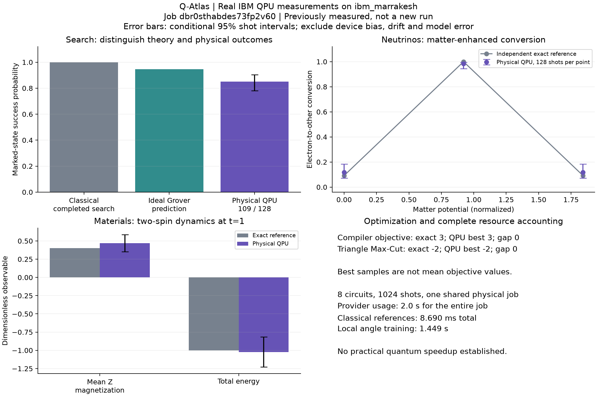

# Q-Atlas: from scientific questions to validated circuits and physical measurements

**Qiskit Fall Fest at The Ohio State University — final science report, November 12, 2026.**

Q-Atlas connects scientific inputs, inspectable Qiskit circuits, independent classical
references, parameter studies, and exported evidence. All five experiences have now
executed on a physical IBM quantum computer. This demonstrates a working experimental
pipeline and small-system physical measurements; it establishes **no practical quantum
speedup**. The platform-wide hypothesis that reusable tooling reduces setup effort is
still unmeasured.

This report follows the supplied *Quantum Computing for Science* challenge notebook by
Anthony Yuhos and Aatmaj Rajesh: problem statement, model, mapping, quantum method,
classical baseline, results, scaling, and impact. Its H2/VQE calculation is a template
for explanation, not an experiment we claim to have implemented. Notebook attribution:
A. Yuhos and A. Rajesh, Qiskit Fall Fest at The Ohio State University, 2026; text CC BY
4.0, code Apache 2.0.

## 1. What concrete scientific question do we investigate?

**How does matter alter electron-neutrino flavor conversion, and how accurately can
a small quantum circuit reproduce that dependence with finite measurements?**

Flavor-sensitive detectors observe different event rates when propagation changes
flavor probabilities. We study a controlled effective two-flavor model, rather than
attempting realistic stellar transport or a new neutrino-physics discovery.
Matter changes both effective mixing and propagation phase.
[PDG neutrino review, sections 14.4–14.5](https://pdg.lbl.gov/2025/reviews/rpp2025-rev-neutrino-mixing.pdf)

The fixed demonstration predicts maximum mixing at normalized potential
`cos(0.4) = 0.9210609940` for theta=0.2 and splitting/energy=1. At distance
`pi/(2 sin(0.4)) = 4.0336988686`, it also predicts complete conversion there.
Independent analytical and numerical calculations test that prediction. Ideal circuits
should agree to numerical precision; physical measurements reveal additional errors.

The platform supports related, separately defined questions:

| Experience | Concrete question | Quantity scientists/users inspect |
| --- | --- | --- |
| Neutrinos | How does matter change flavor conversion? | Flavor probability versus potential or distance |
| Materials | How accurately does a product-formula circuit reproduce spin dynamics? | Magnetization, bond correlations and energy; approximation and sampling error |
| Optimization | How close does bounded QAOA get to the same problem's exact optimum? | Assignment, objective gap, resources and measured costs |
| Compiler | Does safe translation preserve a supported binary objective? | Source/QUBO equivalence and the resulting solver comparison |
| Search | How do Grover success and query requirements depend on iterations and size? | Success probability, query counts, circuit resources and runtime |

These are not one universal physical model. Their shared contribution is an inspectable,
reproducible comparison workflow. Expected patterns include resonance, Trotter
convergence in its applicable regime, finite-shot uncertainty, and oscillatory Grover
success. A systematic circuit/reference disagreement, wrong bit order or changed
objective would falsify the implementation's correctness claim.

## 2. What models and assumptions do we use?

### Neutrino flavor propagation

Encode electron flavor as `|0>` and one effective other flavor as `|1>`, starting
in electron flavor. Assume coherent propagation at fixed energy through prescribed
constant or ordered piecewise-constant ordinary matter. In natural units, the
trace-subtracted physical Hamiltonian is

```text
H = (Delta m² / 4E) sin(2 theta) X
  + [s V/2 - (Delta m² / 4E) cos(2 theta)] Z,
s = +1 for neutrinos; -1 for antineutrinos.
```

Removing the identity term changes only global phase. The app takes dimensionless
normalized inputs, with theta in radians, not direct km/GeV/density measurements.
Its implemented generator is

```text
kappa = delta_m2 / energy
x = kappa sin(2 theta)
z = s potential - kappa cos(2 theta)
G = xX + zZ; r = sqrt(x²+z²); U(L) = exp(-iGL)
P(e -> other) = (x²/r²) sin²(rL), if r != 0.
```

For r=0, evolution is identity. Resonance is z=0 with nonzero transverse mixing;
complete conversion additionally needs the correct distance. A peak in mixing does
not imply complete conversion at every baseline. The model excludes three-flavor
interference, CP phases, absorption, decoherence, energy spectra and neutrino-neutrino
interactions. It is classically easy. See [units and conventions](NEUTRINOS.md).

### Materials dynamics

The implemented open Ising chain has Pauli-spin Hamiltonian

```text
H = -J sum_i Z_i Z_(i+1) - h sum_i X_i,
psi(t) = exp(-iHt)|00...0>, hbar=1.
```

The local experiment supports 2–4 spins. Time and energy are dimensionless simulation
units. This is real-time dynamics, not ground-state VQE or a realistic bulk material.
We measure mean Z magnetization, every nearest-neighbor ZZ correlation, and total
energy. The initial state is generally not the ground state. The hardware example
uses N=2, J=1, h=0.7, t=1 and four symmetric product-formula steps.

### Binary optimization and compiler

For binary x, canonical minimization is

```text
C(x) = c + sum_i a_i x_i + sum_(i<j) b_ij x_i x_j.
```

Binary squares reduce to linear terms; maximization negates the original objective,
including its constant. An edge contributes `w(x_i+x_j-2x_ix_j)` to Max-Cut, so its
negative defines the minimized QUBO. The hardware graph is a unit-weight triangle,
whose exact maximum cut is 2 and canonical optimum is -2.

The compiled hardware example is `5-2*red+blue+red*blue`. Its four assignments
`00,01,10,11` have values `5,6,3,5`; the exact optimum is 3 at `10`.
The compiler parses an allowlisted AST, performs bounded symbolic extraction and
exhaustive small-instance equivalence checks. It never executes uploaded Python.

## 3. How are the models mapped to qubits and gates?

| Experience | Encoding and circuit | Important implementation choice |
| --- | --- | --- |
| Neutrinos | One qubit for two flavors; each layer uses chronological `RY(-alpha), RZ(2rL), RY(alpha)` with alpha=atan2(x,z) | Exact constant-layer propagator; no Trotter approximation or entangling gates |
| Materials | Spin i is qubit i; symmetric ZZ/X/ZZ product formula | ZZ half-step `RZZ(-J dt)` and X full-step `RX(-2h dt)`; two measurement bases |
| Compiler/Optimization | One qubit per binary variable; shared QAOA cost and X-mixer layers | The compiler and Optimization reuse the same circuit/angle engine |
| Search | Uniform superposition; explicitly marked-state phase oracle followed by diffusion | Qiskit count strings are reversed to the API's x[0]-first convention |

Neutrino rotations align the Hamiltonian axis with Z, apply the propagation phase,
then return to flavor basis. The factor of two follows the half-angle definition
of quantum rotations. At the selected resonant distance the propagator reduces to
X up to global phase: IBM's compiler reduced that point to **one X plus measurement**.
This is an understandable sanity check. The neighboring off-resonance points, which
retain rotations and phases, provide additional validation of the physical mapping.

For Materials, let H=A+B separate the ZZ and X terms. With dt=t/r, repeat
`exp(-iA dt/2) exp(-iB dt) exp(-iA dt/2)` r times. The blocks generally do not commute;
their splitting causes approximation error. The convergent global error is second
order in step size, with constants depending on the Hamiltonian and time.
[Childs et al., A Theory of Trotter Error](https://arxiv.org/abs/1912.08854)

Z-basis shots jointly estimate Z and ZZ. Hadamards before measurement give X
expectations in the second basis. Energy combines both settings. Correlations use
products within the same shot, rather than products of separate means. Thus Materials
uses `2 × shots × time_points` samples. API strings list x[0] first; native Qiskit
strings place qubit zero on the right. Boundary conversion is explicit and tested.

## 4. What quantum methods run, and why these methods?

**Neutrinos:** exact one-qubit rotations expose the relationship between the physical
generator, accumulated phase and detection probability without introducing an
unnecessary optimizer. **Materials:** a product formula makes the circuit-depth versus
approximation-error tradeoff visible.

**Compiler/Optimization:** QAOA starts in `|+>^n`, alternating
`exp(-i gamma_l C)` and `exp(-i beta_l sum X)`. A classical COBYLA optimizer trains
2p angles. The recorded hardware runs use p=1, a budget of 20 local evaluations,
seed 42 and final physical sampling. Training uses ideal local statevector
expectations; only the bound final circuits are sampled on the QPU. This is a hybrid
workflow, not hardware-based angle optimization. Best sampled objective and mean
expectation are different statistics.
[Farhi, Goldstone and Gutmann, QAOA](https://arxiv.org/abs/1411.4028)

**Search:** Grover amplification has ideal marked probability
`sin²((2k+1)theta)`, theta=`asin(sqrt(M/N))`. The experiment uses N=8, M=1 and k=2,
giving ideal success 121/128=0.9453125. Excessive iterations can reduce success.
The app knows the target to build its oracle; this demonstrates an oracle model,
rather than discovering an unknown database answer without paying for its oracle.
[IBM's Grover explanation](https://quantum.cloud.ibm.com/learning/en/modules/computer-science/grovers)

All five experiences offer physical IBM execution, local comparisons, bounded
parameter studies, explicit status/error handling and evidence export. Hardware
submission is separate from source conversion or page loading.

## 5. What are the classical baselines, and what comparisons are fair?

- Neutrinos: a directly constructed 2×2 Hamiltonian propagated with independent
  SciPy matrix exponentials; a separate constant-layer analytical formula is available.
- Materials: a NumPy Kronecker-product Hamiltonian and SciPy dense evolution,
  independent of circuit construction. “Exact” means without the product-formula
  approximation, up to floating-point error.
- Compiler/Optimization: exhaustive assignment enumeration solves the same canonical
  objective, including constants. The existing stress-study CLI also includes a seeded
  multistart bit-flip heuristic for stronger scaling comparisons.
- Search: lexicographic classical search without replacement. For the fixed target
  `001`, it observed **2 checks**. The separately reported uniform-position expectation
  is 4.5 and worst case 8. The mean is not the observed cost of this fixed instance.

These are valid correctness or solution-quality comparisons on matched inputs.
Runtime scopes differ: exact probability computation is not the same workload as
building/transpiling circuits and collecting finite samples. The quantum optimizer's
local preparation is real work. Provider usage excludes local work and must not be
presented as an end-to-end speedup.

## 6. What did the physical experiment measure?

**Completed IBM job:** `dbr0sthabdes73fp2v60`, device **ibm_marrakesh**,
`simulated: false`. One shared job contained eight circuits, 128 shots each,
for 1024 total samples. Per-experiment measurements are separate; provider usage and
queue/wall intervals belong to the whole job.



The figure's probability error bars are 95% Wilson binomial intervals. Materials
bars use approximate 95% intervals for the mean, calculated from joint-shot sample
variances and independent Z/X batches. These conditional shot intervals exclude
device bias, calibration drift, Trotter error and model uncertainty. This is one job,
not an independent repeated-hardware study.
[SciPy interval definition](https://docs.scipy.org/doc/scipy/reference/generated/scipy.stats._result_classes.BinomTestResult.proportion_ci.html)

| Experience / quantity | Independent reference | Physical result | Absolute error / gap |
| --- | ---: | ---: | ---: |
| Compiler best objective | 3 | 3 at `10` | 0 |
| Triangle minimized objective | -2 | -2 at `001` | 0 |
| Search marked success | Ideal Grover 0.9453125; completed exact classical search 1 | 109/128 = 0.8515625 | 0.09375 from ideal; 0.1484375 from completed classical success |
| Materials mean Z magnetization | 0.403062466 | 0.46875 | 0.065687534 |
| Materials total energy | -1 | -1.021875 | 0.021875 |
| Neutrino conversion at potential 0 | 0.091882682 | 15/128 = 0.1171875 | 0.025304818 |
| Neutrino conversion at potential 0.921060994 | 1 | 126/128 = 0.984375 | 0.015625 |
| Neutrino conversion at potential 1.842121988 | 0.091882682 | 15/128 = 0.1171875 | 0.025304818 |

Compiler and Optimization recovered exact optima among their samples; this does not
mean every shot was optimal. Search's Wilson interval is approximately [0.7798,0.9029],
below its ideal prediction. That motivates investigation of physical implementation
errors; the present data do not isolate gate, readout or drift contributions.
The resonant neutrino interval is approximately [0.9448,0.9957]; 126 successes are
consistent with high conversion but do not certify an ideal error-free device.

A post-hoc local ideal simulation of the *same Materials logical circuit* gives
Mz=0.393521730 and E=-0.965625326. Relative to exact evolution, Trotter errors are
approximately 0.009540736 and 0.034374674. Physical-minus-ideal discrepancies also
include sampling/device effects. Their signs can cancel: the physical energy being
closer to exact than the ideal product-formula energy does not establish noise-assisted
improvement. Conditional shot standard errors are approximately 0.05967 for Mz and
0.10507 for energy. See [the post-hoc reference](evidence/ibm-qpu-2026-11-12/ideal-materials-reference.json).

Earlier local work independently recorded nine neutrino potential curves, across
three shot counts and three base seeds (81 point records). Maximum ideal conversion
probability error against SciPy was approximately 3.05e-16. That validates the ideal
mapping separately from hardware behavior. The [earlier dataset](evidence/fall-fest-2026-11-12/neutrino-resonance.json)
is explicitly local Aer simulation, not physical data.

### Executed circuit resources

| Experience | Logical qubits | Circuits | Native depths | Native CZ counts |
| --- | ---: | ---: | --- | --- |
| Compiler | 2 | 1 | 18 | 2 |
| Optimization | 3 | 1 | 49 | 9 |
| Search | 3 | 1 | 169 | 45 |
| Materials | 2 | 2 measurement bases | 62, 62 | 10, 10 |
| Neutrinos | 1 | 3 curve points | 6, 2, 6 | 0, 0, 0 |

IBM's ISA circuits contain a 156-wire physical register, mostly idle; these are
**1–3 logical-qubit experiments**, not 156-qubit scientific simulations. Native
routing/gate decomposition adds costs absent from a query count. The exact executed
[QPY circuits](evidence/ibm-qpu-2026-11-12/executed-circuits.qpy) were retrieved from the
completed job, with [gate counts and qubit mappings](evidence/ibm-qpu-2026-11-12/executed-circuits.json).
Use the small logical builders for statevector checks; do not allocate a statevector
over the entire expanded physical register.

### Runtime and usage accounting

| Measurement | Recorded value | Scope |
| --- | ---: | --- |
| Classical references | 8.690098 ms total | All five independent classical paths |
| Local QAOA angle training | 1449.293785 ms | Compiler plus Optimization |
| Preparation | 1662.300447 ms | Includes classical and training work; not additive to them |
| Transpilation | 53.798634 ms | Eight circuits |
| Submission | 576.632101 ms | Remote submission/acknowledgement |
| Result retrieval | 145.465773 ms | Shared result download |
| Provider created-to-running interval | 1057.424 ms | Provider timestamps |
| Provider running-to-finished interval | 4218.872 ms | Includes provider processing/contention, not just QPU use |
| Provider QPU usage | 2.0 s | Entire shared job; unavailable per experiment |
| Observed wall time | 96003.261 ms | Includes delayed polling |

These intervals can overlap or contain other intervals. They cannot be added into
a new total or divided into a valid per-experiment speedup. Provider RUNNING duration
and usage measure different things.
[IBM timing guidance](https://quantum.cloud.ibm.com/docs/en/ibm-quantum-compute/monitor-job)

## 7. Where does quantum computing fit as the problem scales?

| Problem | Classical structure and alternatives | Quantum promise and present limitation |
| --- | --- | --- |
| Current two-flavor propagation | Fixed 2×2 matrices; increasing layers does not create exponential state growth | One qubit, three rotations per active layer; no scaling advantage claimed |
| Current 1D transverse Ising model | Dense matrices grow as 4^N entries, but this special chain has efficient free-fermion structure; tensor-network alternatives matter | N logical qubits with depth and measurement costs; dense-reference growth alone is not advantage evidence |
| Binary optimization | Exact enumeration is exponential, but competitive heuristics/structured solvers can be much faster | QAOA quality, optimization cost, depth and noise must be compared fairly; no universal speedup guarantee |
| Unstructured search | Linear oracle-query scaling at fixed success requirements | Grover has quadratic oracle-query scaling under its assumptions; oracle construction/gate/runtime costs remain |

For the Ising chain's special classical structure, see
[Mbeng, Russomanno and Santoro](https://arxiv.org/abs/2009.09208).
For search theory, see [Grover's original algorithm](https://arxiv.org/abs/quant-ph/9605043).

Thus our clearest established quantum benefit is a **theoretical query reduction**,
not an observed application runtime win. Larger local simulations still run on a CPU
and retain exponential classical work; our QAOA statevector scorer explicitly evaluates
all assignment costs. Better qubits do not remove oracle cost, state preparation,
measurement or classical optimizer work. More parameters alone cannot force a crossover.

## 8. What is the impact, and what is creative about the project?

The contribution is the connection between understandable science, transparent
resources, independent comparisons and extensible objective translation. Established
algorithms become inspectable experiments rather than unsupported “quantum faster”
badges. The final implementation fits all five experiences into one physical job
while retaining separate references and measurements.

That engineering choice used one 10-second local reservation when only 10 seconds
remained in the configured cap. Actual usage was 2 seconds. It does not establish
measured usage savings versus five independent jobs, which were not run.

| If validated and extended | What a scientist/student could do | Work still needed |
| --- | --- | --- |
| Richer flavor/profile models | Connect propagation conditions to predicted flavor-sensitive signals | Physical units, three-flavor physics and external model validation |
| Resource/error studies | Choose circuit resolution and shots for a required observable error | Repeated jobs, stronger uncertainty and hardware-noise analysis |
| Reusable objective translation | Explore supported quadratic objectives without rebuilding circuit plumbing | Measured setup-effort study and broader safely validated syntax |
| Matched performance studies | Decide when a quantum method merits further investigation | Competitive classical baselines, equal quality and complete costs |

We do not claim invention of QAOA, Grover, quantum neutrino simulation or Ising
simulation. Creativity lies in the reproducible, extensible workflow and its careful
integration. The platform hypothesis requires a matched user/developer study before
we can claim it reduces investigation effort.

## 9. How is it reproducible, validated and safe?

The [raw physical evidence](evidence/ibm-qpu-2026-11-12/five-experiments.json) includes
inputs, references, angles, counts, native depths, versions, job/device IDs and timings.
[Provenance](evidence/ibm-qpu-2026-11-12/provenance.json) records source hashes and the
dirty working tree based on `5786fd1`; that commit alone does not identify all measured
source changes. The exact retrieved QPY circuits and their digest preserve executed
circuits independently of a later provider calibration.

The software environment recorded Qiskit 2.6.2, Aer 0.18.2, IBM Runtime 0.47.0,
NumPy 2.5.4 and SciPy 1.18.1. Local seeds and versions are retained. Hardware counts
are stochastic and do not promise exact replication on a later device calibration.

From the repository root, start `./dev.sh`. Open `/hardware/` for the completed job
or explicitly select **Load recorded physical demo** for an offline archive view.
Each experience has local single runs and bounded one-axis/seed studies with raw
JSON export. The Methodology page provides the report and figures.

From `backend/`, retrieve the existing job without submitting another:

```sh
.venv/bin/python -m scripts.run_hardware_demo --refresh --output /tmp/physical-qpu.json
```

Recreate the figure without contacting IBM:

```sh
MPLCONFIGDIR=/tmp/qatlas-matplotlib backend/.venv/bin/python \
  docs/evidence/ibm-qpu-2026-11-12/plot_final_results.py
```

SDK credentials load privately from ignored `.env` settings. Hardware submissions
require an explicit action, use bounded resources and an idempotent persisted UUID,
and recover uncertain acknowledgements by job tag. Simulator and hardware schemas
are distinct. Unknown/failed results never become fabricated measurements. Uploaded
Python is parsed and validated, never executed. Browser cancellation prevents further
study scheduling; existing worker deadlines enforce local computation bounds.

Automated checks cover model controls, unitary/sign/bit-order conventions, tiny
objective equivalence, seeded simulations, contracts, timing and summary arithmetic,
timeouts, raw evidence, quota accounting, lost acknowledgements and concurrent polling.
Hardware adapter tests mock provider services; they are separate from the real job.
Final app verification and presentation steps are in the
[readiness notes](PRESENTATION_READINESS.md) and [runbook](PRESENTATION_RUNBOOK.md).

## 10. What do the evidence and limitations allow us to conclude?

Q-Atlas now completes the promised workflow across all five experiences and preserves
real physical-QPU evidence. Ideal simulation checks and physical measurements answer
different questions, and both are available. The main scientific demonstration shows
matter-enhanced conversion, finite measurement uncertainty, and departures from ideal
behavior on a device. Supporting experiments expose approximation, objective quality
and query/resource tradeoffs.

The present evidence consists of tiny instances and one shared hardware job. It has
no controlled repeated-device study, no isolated error-source attribution, no full
three-flavor or many-body neutrino physics, no hardware-based QAOA optimizer training,
and no demonstrated practical runtime advantage. Classical setup-effort reduction
and batching usage savings remain unmeasured.

The next scientific study should vary one resource at a time, repeat independent
hardware jobs, measure calibration/noise effects, compare matched outputs/quality
with competitive classical methods, and retain the full executed circuits. Those
future measurements extend this finished demonstration rather than change what its
current results establish.
