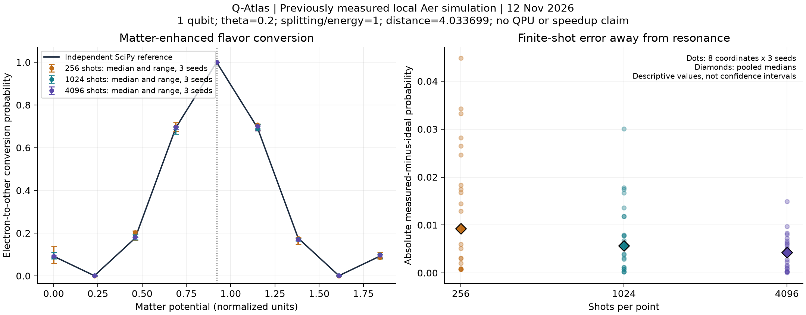

# Q-Atlas — Quantum Computing for Science challenge answers

**Final report:** [FINAL_SCIENCE_REPORT.md](FINAL_SCIENCE_REPORT.md) answers these
questions using the completed app and physical measurements. The earlier study and
readiness notes below retain their original context.

**Hardware update:** all five experiences have now run on a physical IBM QPU.
Job `dbr0sthabdes73fp2v60` completed on `ibm_marrakesh`: eight circuits, 128 shots each,
with 2.0 seconds of provider-reported usage for the entire shared job. Compiler and
Optimization sampled their exact optima; Search succeeded in 109/128 shots; neutrino
resonance conversion was 126/128. Materials observables and all raw measurements are
in the [physical results report](evidence/ibm-qpu-2026-11-12/RESULTS.md).
These establish real hardware execution, without establishing practical speedup.
The simulator studies and readiness checks below describe the earlier local work.

Prepared November 12, 2026. This document follows the problem → model → mapping →
method → classical comparison → results → scaling → impact structure of Anthony Yuhos
and Aatmaj Rajesh's *Quantum Computing for Science*, Qiskit Fall Fest @ The Ohio State
University, 2026, supplied at `~/Downloads/quantum_for_science_challenge.ipynb`.
The notebook's text is licensed CC BY 4.0 and its code Apache 2.0. We use its reporting
structure, not its H2 calculation or numerical results.

**Submission claim:** Q-Atlas makes small quantum experiments inspectable and
reproducible, connecting scientific inputs to circuits, classical references and
measured errors. Our local simulator evidence validates implementations; it does not
establish practical quantum speedup. The broader hypothesis that the platform reduces
setup effort remains unmeasured: see [SCIENTIFIC_HYPOTHESIS.md](SCIENTIFIC_HYPOTHESIS.md).

## 1. What concrete scientific question do we answer?

**How does a constant matter potential alter electron-neutrino flavor conversion,
and how accurately does a one-qubit circuit reproduce that dependence with finite
measurements?** This is the recommended main demonstration. Materials, search and
optimization are supporting experiments within the same platform.

Neutrinos are observed through flavor-sensitive interactions. A change in flavor
probability changes what a detector would expect to see. Matter changes the effective
mixing and oscillation phase. Our controlled two-flavor model lets us separate this
physical effect from numerical error and finite-shot uncertainty.
[PDG, Neutrino Masses, Mixing, and Oscillations, sections 14.4–14.5](https://pdg.lbl.gov/2025/reviews/rpp2025-rev-neutrino-mixing.pdf)

For theta=0.2 and normalized splitting/energy=1, we predict maximum mixing at matter
potential `cos(0.4) ≈ 0.921061`. With distance `pi/(2 sin(0.4)) ≈ 4.033699`, the model
also predicts complete conversion there. Ideal-circuit results should agree with an
independent classical calculation to numerical precision. Typical sampling uncertainty
should fall with increased shots; individual observed errors need not decrease.

These predictions are falsifiable: a displaced resonance, incorrect antineutrino sign,
non-normalized probabilities, or systematic circuit/reference disagreement would
invalidate the implementation. A large sampling discrepancy requires statistical
investigation, not automatic dismissal as noise.

## 2. What model and assumptions are used?

We retain two effective flavors: electron `|0>` and other active flavor `|1>`. Start
in electron flavor and assume coherent propagation at fixed energy through prescribed
static matter. The physical trace-subtracted Hamiltonian is

```text
H = (Delta m² / 4E) sin(2 theta) X
  + [s V/2 - (Delta m² / 4E) cos(2 theta)] Z,
s = +1 for neutrinos and -1 for antineutrinos.
```

The identity part only contributes a global phase, so removing it does not change
flavor probabilities. The app takes normalized dimensionless quantities, with theta
in radians. It does not accept direct km, GeV or physical density inputs.

The implemented generator and probability are

```text
kappa = delta_m2 / energy
x = kappa sin(2 theta)
z = s potential - kappa cos(2 theta)
G = xX + zZ,   r = sqrt(x² + z²),   U(L) = exp(-i G L)
P(e -> other) = (x²/r²) sin²(rL),  if r != 0
P(e -> electron) = 1 - P(e -> other).
```

When `r=0`, evolution is identity. Resonance means `z=0` with nonzero transverse
mixing; complete conversion additionally requires the right distance. A mixing peak
does not imply a probability peak at every baseline. These are the repository's
specific conventions, detailed in [NEUTRINOS.md](NEUTRINOS.md) and
[physics.py](../backend/app/experiments/neutrinos/physics.py).

This is not full three-flavor phenomenology, a solar/supernova model, or a new physics
discovery. It omits CP phases, absorption, decoherence, energy spectra and
neutrino-neutrino interactions. The normalized values are illustrative rather than
fitted experimental parameters.

## 3. How is the model mapped to a quantum circuit?

One qubit encodes the two flavor amplitudes. There is no fermion-to-qubit mapping,
variational ansatz or VQE loop in this experiment. With `alpha=atan2(x,z)`, a layer is

```text
U = RY(alpha) RZ(2rL) RY(-alpha).
Chronological gate order: RY(-alpha), RZ(2rL), RY(alpha), then measurement.
```

The Y rotations align the Hamiltonian axis with Z; the Z rotation applies the relative
propagation phase; the final rotation returns to the flavor basis. The factor of two
comes from the half-angle definition of rotation gates. The circuit implements the
constant-layer propagator exactly up to floating-point arithmetic and global phase.

The demonstrated model has **1 qubit, 2 Hamiltonian Pauli terms, 0 variational
parameters, 3 rotation gates per active layer, 0 entangling gates, and depth 4 including
measurement for one active layer**. Those are the counterparts of the notebook's
qubit/Pauli/parameter resource counts. Parameters are calculated from physics, not
trained. Ordered layers compose in propagation order. There is no Trotter error in
this exact constant-layer construction.

See [circuit.py](../backend/app/experiments/neutrinos/circuit.py) and
[experiment.py](../backend/app/experiments/neutrinos/experiment.py) for the actual
Qiskit implementation. Aer runs both an ideal statevector and finite-shot measurement.
Both execute on a classical computer.

## 4. What is the classical baseline, and why is it fair?

The independent baseline constructs the 2×2 Hamiltonian with NumPy and propagates
it using SciPy's matrix exponential; it does not obtain its matrix from the circuit.
For one constant layer we also have the analytical probability above. All three
paths use the same inputs, initial flavor and measured quantity.

This is a fair **correctness comparison**. It is not yet a matched runtime comparison:
the circuit path performs construction, transpilation, ideal simulation and shot
sampling, while the reference computes exact probabilities. Recorded timing scopes
remain separate. Classical linear algebra is entirely practical for this model.

We distinguish ideal-circuit minus reference error, measured minus ideal sampling
error, and measured minus reference total error. Absolute component errors do not
necessarily add. For a Bernoulli probability, theoretical standard error is
`sqrt(p(1-p)/shots)`; an all-success sample does not by itself certify a true
probability of one.

## 5. What did we measure?

**New local simulator evidence, recorded 2026-11-12 at 17:35:53 UTC:** nine equally
spaced potentials from 0 to 1.842121988; shots `{256,1024,4096}`; three base seeds
`{42,142,242}` per shot count. All other settings use the fixed scientific case above.
The runner increments each base seed by point index, retaining effective seeds.
That is **9 curve requests, 81 point results, and 145152 measurement shots**.

Python 3.12.16, Linux x86_64; NumPy 2.5.4, SciPy 1.18.1, Qiskit 2.6.2,
Aer 0.18.2. Source revision `5786fd1` had pre-existing uncommitted changes; the
[provenance file](evidence/fall-fest-2026-11-12/provenance.json) records relevant source
hashes. [Raw responses](evidence/fall-fest-2026-11-12/neutrino-resonance.json) and the
[recomputed evidence review](evidence/fall-fest-2026-11-12/neutrino-resonance-review.md)
are preserved. This evidence used no hardware or external quota.



| Normalized potential | Ideal conversion | Measured median, 4096 shots | Observed min–max over 3 seeds |
| --- | ---: | ---: | ---: |
| 0 | 0.091882682 | 0.092773438 | 0.085205078–0.093505859 |
| 0.460530497 | 0.176668401 | 0.181640625 | 0.178955078–0.181884766 |
| 0.690795746 | 0.694131509 | 0.697998047 | 0.685791016–0.698730469 |
| 0.921060994 | 1.000000000 | 1.000000000 | 1.000000000–1.000000000 |
| 1.151326243 | 0.694131509 | 0.700195312 | 0.679199219–0.702148438 |
| 1.381591491 | 0.176668401 | 0.170410156 | 0.166992188–0.175292969 |
| 1.842121988 | 0.091882682 | 0.097656250 | 0.089111328–0.099121094 |

Selected rows above; the figure and raw evidence retain all nine coordinates.
The maximum ideal-versus-SciPy **conversion-probability** discrepancy across all 81
records was `3.0531133177191805e-16`. At resonance all runs returned only the converted
flavor, consistent with the analytical unit probability. Nearby points expose shot
variation more clearly.

As a descriptive pooled statistic, median absolute sampling error over the **eight
off-resonance coordinates × three seeds** was 0.009276 at 256 shots, 0.005655 at 1024,
and 0.004233 at 4096. These 24 values per shot count span different probabilities;
they are not 24 repetitions at one point and do not establish an asymptotic exponent.
The figure's ranges are observed ranges, not confidence intervals. The same base
seeds are reused across shot groups; do not treat them as wholly independent studies.

**Conclusion supported by these data:** the circuit reproduces the controlled
matter-enhanced conversion curve, and finite-shot fluctuations dominate the numerical
discrepancy. **Not established:** new neutrino physics, hardware fidelity, or runtime
advantage. No explicit warmup was used, and timing collection overlapped a test
readiness session. Timing numbers in the raw records are descriptive only.

## 6. When is quantum better than classical in our examples?

The clearest established benefit is **Grover's theoretical oracle-query complexity**,
not a measured speedup of the current app. With one unknown marked item among N
candidates, classical unstructured search needs order N queries and Grover order
sqrt(N) under the query model. A real implementation also pays for oracle construction,
gates, state preparation, measurement and verification.
[IBM Quantum, Grover's algorithm](https://quantum.cloud.ibm.com/learning/en/modules/computer-science/grovers)

For `theta=asin(sqrt(M/N))`, ideal success after k iterations is
`sin²((2k+1)theta)`. The following values are **analytical**, using the best integer
beside the first amplification peak for one mark, not measured runtimes:

| Qubits | Candidates | Grover queries per attempt | Ideal success | Classical expected checks, uniform target position |
| ---: | ---: | ---: | ---: | ---: |
| 2 | 4 | 1 | 1.000000 | 2.5 |
| 3 | 8 | 2 | 0.945313 | 4.5 |
| 4 | 16 | 3 | 0.961319 | 8.5 |
| 5 | 32 | 4 | 0.999182 | 16.5 |
| 6 | 64 | 6 | 0.996586 | 32.5 |

Classical expected checks `(N+1)/(M+1)` assume uniformly distributed marked positions
and no replacement. The implemented lexicographic baseline reports its actual count
for each target separately. Grover success is probabilistic; an ideal repeat-until-
verified-success comparison includes verification, giving expected queries `(k+1)/p`
when attempts are independent. At N=64 this is about 7.024 versus 32.5 classical
expected checks, with all oracle-model assumptions stated. A 1024-shot benchmark uses
1024 circuit attempts; it is not one six-query solve.

The app is given the target strings to build its oracle. This teaches amplitude
amplification; it does not discover an unknown database answer without paying for
the oracle. The existing [recorded search evidence](../frontend/src/lib/search/previously-measured.json)
has n=3, target `001`, k=2: success 986/1024, two actual classical checks, two oracle
queries per shot, about 0.028ms classical versus 101.550ms local simulation. That is
historical simulator evidence, not a new run or a wall-clock quantum win.

For QAOA, we currently have no general speedup guarantee or demonstrated practical
advantage. For one-qubit neutrinos, classical calculation is simple. Making a problem's
weights large does not make its small state space asymptotically hard.

## 7. How do the other experiences work?

| Experience | Model / method | Independent check | What a presenter should explain |
| --- | --- | --- | --- |
| Materials | `H=-J ΣZZ-h ΣX`, open 2–4-spin chain, initial all-zero state; symmetric second-order product formula | Dense SciPy evolution; special J=0/h=0 cases; full-unitary tests | Why noncommuting blocks cause approximation error; why more steps and more shots address different errors |
| Optimization | Max-Cut becomes canonical minimization of negative cut weight; QAOA alternates cost and X-mixer layers | Exact enumeration plus a documented multistart bit-flip heuristic for scaling studies | Same problem/quality; expectation versus best sample; classical optimizer budget and circuit depth |
| Compiler | Allowlisted AST → polynomial → normalized QUBO → exhaustive small-instance equivalence → shared circuit/runner | Every binary assignment up to six bits, independently specified examples, sign/bit-order tests | Submitted Python is parsed, never executed; restricted optimization compilation rather than arbitrary Python acceleration |
| Search | Phase oracle plus diffusion rotates amplitude toward marked states | Closed-form success probability and explicit classical search | Why too many iterations can reduce success; query counts versus execution cost |

For Materials, `dt=t/r`: each ZZ half-step uses `RZZ(-J dt)` and each X step uses
`RX(-2h dt)`. Two bases estimate Z/ZZ and X, so total shots are
`2 × shots_per_basis × time_points`. This studies dynamics, not ground-state energy.
Second-order product formulas have a controlled approximation regime; the relevant
commutators matter. [Childs et al., A Theory of Trotter Error](https://arxiv.org/abs/1912.08854)

For QAOA, p layers give 2p variational angles, trained locally with COBYLA against an
ideal statevector expectation before final sampling. Increasing shots does not turn
that training into a noisy QPU optimizer. The local scorer explicitly computes all
assignment costs; it retains exponential classical work. Finite-budget training need
not improve with added p. [Farhi, Goldstone and Gutmann, QAOA](https://arxiv.org/abs/1411.4028)

Detailed conventions and evidence: [Materials](MATERIALS.md), [Search](SEARCH.md),
[Compiler](COMPILER.md), [Stress comparisons](STRESS_EXAMPLES.md), and the existing
[whole-project report](PROJECT_SCIENTIFIC_REPORT.md). The Optimization UI is now a
live comparison workspace, including bounded parameter studies. The compiler Test step
offers local execution, with optional hardware sampling kept as an explicitly confirmed
action. See [the release guide](APP_RELEASE_STATUS.md) for current UI behavior.

## 8. Why would quantum help at scale, and what limits us now?

| Model | Classical cost / strong alternative | Quantum resources and present limitation |
| --- | --- | --- |
| Current two-flavor neutrino propagation | 2×2 evolution; cost grows with number of layers, not exponentially with layer count | One qubit and three rotations per layer; no scaling advantage claimed |
| Current 1D transverse-field Ising chain | Generic statevector is 2^N amplitudes; dense matrices 4^N entries. This special model also has efficient free-fermion structure, and tensor networks can be strong baselines | N qubits, product-formula depth and shots; dense-reference difficulty alone does not establish quantum advantage |
| Binary optimization | Exact enumeration is exponential, but heuristics and structured solvers can be much faster | QAOA depth, optimizer evaluations, sampling, noise and solution quality all matter; no universal speedup |
| Unstructured search | Linear oracle queries at fixed success requirements | Quadratic query improvement; implemented oracle/gate costs and full runtime still matter |

The present neutrino model has no many-body entanglement. A future interacting
neutrino model would be a different scientific/algorithmic project, not simply more
layers in this one. Classical state-space growth must be compared with the strongest
applicable algorithms, not just dense diagonalization. We should not extrapolate a
hardware crossover from the small examples.
For the Ising chain's classical structure, see
[Mbeng, Russomanno and Santoro, The quantum Ising chain for beginners](https://arxiv.org/abs/2009.09208).

More reliable hardware would enable deeper circuits and more credible noise studies;
it would not remove state preparation, measurement or classical optimization costs.
Current ideal Aer measurements do not characterize device noise. A hardware study
would need native circuit depth/gates, device/job provenance, shot and error analysis,
and separate training, queue, communication and execution timing.

## 9. What is the impact and the creative contribution?

Our contribution is the inspectable workflow: change a scientific parameter, inspect
the mathematical model/circuit, compare independent predictions, and retain raw evidence.
The compiler extends that workflow to supported user-defined quadratic objectives.
We use established algorithms and do not claim invention of Grover, QAOA, quantum
neutrino simulation, or a new resource reduction.

| If extended and validated | What a scientist or student could do | What remains necessary |
| --- | --- | --- |
| Matter-profile experiments | Relate predicted flavor signals to propagation conditions | Physical unit conversion, richer flavor models and independent validation |
| Resource/error studies | Choose shots or circuit resolution for a target observable error | Repeated measurements, uncertainty and device-noise evidence |
| Reusable optimization compilation | Translate a supported objective without rebuilding circuit plumbing | Broader validated language support and measured setup-effort comparison |
| Reproducible comparisons | Decide whether a quantum method merits further investigation | Competitive classical baselines, comparable quality, complete costs |

This is the challenge's “what would scientists do with it?” answer. The strongest
novelty pitch is the connection between an understandable physics study, transparent
resource tradeoffs, and an extensible compiler—not a claim that a dashboard proves
scientific or computational advantage.

## 10. How can a judge reproduce the result?

Use the existing locked backend environment with the quantum and benchmarks extras.
From `backend/`, choose fresh output filenames; the tools refuse overwrites:

```sh
.venv/bin/python -m app.benchmarks \
  --request ../examples/neutrinos/matter-resonance.json \
  --shots 256 1024 4096 --seeds 42 142 242 --total-timeout 120 \
  --output /tmp/q-atlas-festival-neutrinos.json
.venv/bin/python -m app.benchmarks.review \
  /tmp/q-atlas-festival-neutrinos.json \
  --output /tmp/q-atlas-festival-neutrinos-review.md
```

Reproduce the saved figure from the repository root without running any simulation:

```sh
MPLCONFIGDIR=/tmp/qatlas-matplotlib backend/.venv/bin/python \
  docs/evidence/fall-fest-2026-11-12/plot_neutrino_evidence.py
```

The evidence validator recomputes summaries and checks raw-record consistency. It does
not establish scientific novelty or performance advantage. Seeded counts are tied to
the recorded implementation and package versions; wall-clock times will vary.

The [final-day roadmap](FALL_FEST_ROADMAP.md) specifies owner tasks, bounded studies,
integration gaps and release criteria. Readiness-check results are appended below.

## Readiness checks performed November 12

| Check | Result |
| --- | --- |
| Full backend pytest suite | **1046 passed**, 68 dependency deprecation warnings, 58.66s |
| Backend Ruff lint and format | Passed; 122 files already formatted |
| Frontend `npm run check` | Passed; zero errors and warnings |
| Frontend `npm test` | All 10 test-file subtests passed |
| Frontend `npm run test:compiler` | All 7 tests passed |
| Frontend `npm run types:check` | Passed; generated API types match |
| Frontend `npm run build` | Passed; static production build generated |
| Saved neutrino evidence | Existing review tool validated all nine curves and recomputed summaries |
| Presentation artifacts | Figure rendered and visually inspected; plot helper lint/format and local document links checked |

The sandboxed pytest run stalled in FastAPI/Starlette TestClient startup; it was
interrupted, then a bounded diagnostic run timed out. An approved rerun outside the
sandbox completed the full suite successfully. The 68 warnings concern an IBM Runtime
transpiler-plugin deprecation, not failed tests. These checks describe the current
working tree, including pre-existing edits. This pass did not implement the proposed
UI integrations or perform a manual browser rehearsal, and it submitted no QPU jobs.
